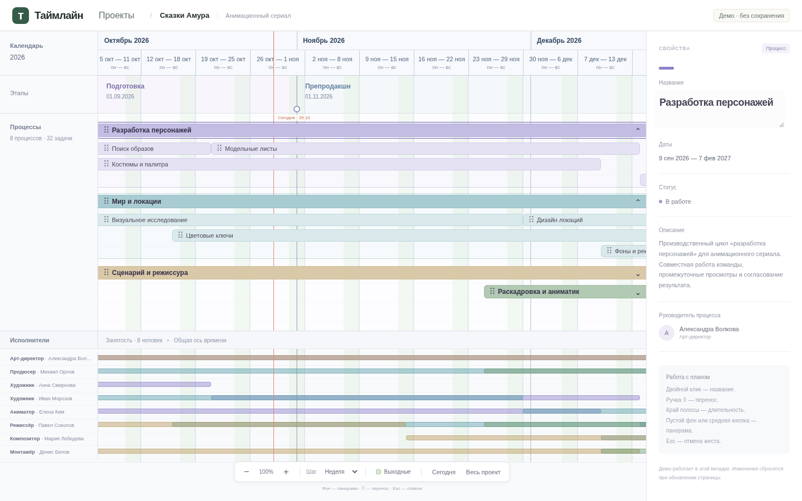

# Таймлайн — V1.1 «Календарь прежде всего»

Настольный браузерный редактор производственного плана. **V1.1** исправляет читаемость календаря поверх работающего V1, сохраняя Vite + React + TypeScript strict + Zod. Сразу открывается рабочий масштаб **14 CSS px/день**, то есть **98 px на неделю**, с сегодняшней датой в первой трети временного viewport. Демо «Сказки Амура» содержит год, четыре этапа, восемь процессов, 32 задачи, восемь исполнителей и 40 назначений; год больше не сжимается в экран при запуске.

Актуальный контракт: [ТЗ V1.1](docs/specs/v1.1/01_NEXT_TZ_CALENDAR_V1_1.md) и [архитектурная дельта](docs/specs/v1.1/02_ARCHITECTURE_DELTA.md). Предыдущий комплект V1 сохранён в [docs/specs](docs/specs/04_CODEX_FIRST_PROMPT.md); прежние `ARCHITECTURE.md` / `CODEX_SPEC.md` остаются историческими. [PDF-референс](docs/reference/production-timeline.pdf) используется для горизонтальной композиции, а не как изображение интерфейса.



Дополнительно: [«Весь проект», 1440×900](docs/screenshots/calendar-v1-1-project-1440.png) и [рабочий масштаб 1920×1080](docs/screenshots/calendar-v1-1-work-1920.png). Это реальные screenshots браузера. Предыдущие снимки V1 сохранены отдельно.

## Запуск

Node.js **24.19.0**, npm. Команды — из корня репозитория:

```sh
npm install
npm run dev
```

Для установки точно по lockfile: `npm ci`. При наличии nvm можно предварительно выполнить `nvm install && nvm use`.

```sh
npm run lint
npm run build
npm run test
npx playwright install --with-deps chromium
npm run test:e2e
```

`build` выполняет strict typecheck приложения, инструментов и тестов, затем сборку Vite. `test:e2e` сам запускает и останавливает `vite preview`, поэтому нужна актуальная сборка. В текущей облачной среде проверяется установленный Chromium:

```sh
npm run build
PLAYWRIGHT_CHROMIUM_EXECUTABLE_PATH=/usr/bin/chromium npm run test:e2e
```

Playwright также обновляет три screenshot-файла V1.1 в `docs/screenshots/`. Для просмотра production-сборки отдельно: `npm run preview`. Приложению не нужны вход, сервер, API-ключи, настройка сети, Supabase или ChatGPT. После установки зависимостей оно работает без внешних запросов.

## Календарь V1.1

- Двухуровневая шапка: настоящие месяцы/годы и ячейки выбранного шага. День, 2/3 дня, неделя, две недели и месяц дают свои подписи и реальные границы; неделя начинается с понедельника. При отдалении сокращается/пропускается только текст, а не календарные интервалы.
- Общая модель CalendarCell задаёт границы шапки, этапов, процессов и исполнителей. Месячные линии выражены сильнее, выходные — спокойный бледно-зелёный фон. Сегодня и границы этапов остаются отдельными маркерами.
- Настоящая фиксированная левая колонка 176 px отделена DOM-раскладкой от времени; она не закрывает полосы. Ширина инспектора и gutter не участвуют в расчёте камеры. У длинных полос, начавшихся до окна, название и ручка переноса остаются в видимой части; настоящие границы дат не меняются.
- **Сегодня** центрирует актуальную локальную дату и возвращает как минимум рабочий zoom. **Весь проект** явно подгоняет диапазон по измеренной ширине времени, включая работы, вышедшие за исходные границы проекта. Это единственная автоматическая подгонка; resize окна сохраняет pan/zoom.
- Нажатие на круглый маркер этапа открывает компактный ввод даты. «Применить» и drag вызывают одну проверяемую команду; пересечение соседних этапов отклоняется. ISO хранится в модели, подписи остаются русскими.
- Zoom и шаг сетки независимы. Все изменения вида оставляют даты, ревизии, дорожки и назначения без изменений.

## Что работает

- Общая горизонтальная календарная ось: ruler с месяцами и датами, прозрачная сетка, этапы, процессы, задачи и занятость. Даты определяют ширину полос; CSS-позиции не зашиты в демо.
- Четыре StageBand с общими StageMarker-границами. Круглая ручка и прямой ввод меняют дату; подписи и обе соседние области обновляются. Этапы не являются контейнерами процессов.
- Клик по процессу выделяет его, показывает свойства и раскрывает task lanes; другие процессы остаются раскрыты. Шеврон отдельно сворачивает группу. Параллельность/последовательность задана дорожками, без автоупаковки.
- Двойной клик по названию полосы — inline-ввод; Enter подтверждает, Esc отменяет. Название в правой панели тоже редактируется, Enter или уход из поля подтверждает его. Остальные поля инспектора пока только для чтения.
- Маленькая ручка ⠿ переносит процесс/задачу с календарным snap. Левый и правый края меняют длительность. Обычное нажатие/протаскивание текста не переносит работу.
- Перенос процесса сдвигает детей ровно один раз. Выход задачи за родительские даты расширяет процесс. Нельзя обрезать детей процессом, создать нулевой интервал или наложить работы в одной дорожке; ошибка объясняется рядом со сценой.
- Pointermove показывает временный preview; pointerup подтверждает один результат. Esc, pointercancel, потеря захвата и blur отменяют жест.
- ЛКМ на пустом фоне и удержание средней кнопки — pan без изменения данных. `+`/`−` масштабируют относительно центра viewport. Шесть шагов grid/snap независимы от zoom; недели начинаются с понедельника, месяцы — настоящие календарные.
- «Выходные» переключает бледно-зелёные полосы и не меняет сроки. Линия «Сегодня» использует локальную дату устройства и обновляется в полночь/при возвращении на вкладку.
- Нижняя занятость использует ту же камеру. Hover задачи/процесса подсвечивает назначенных людей; hover полосы занятости подсвечивает связанную работу.
- Кнопка «Проекты» открывает обзор; возврат к проекту сохраняет изменения документа в текущем сеансе.

## Что пока не работает

**Данные только в памяти вкладки; перезагрузка сбросит изменения.** IndexedDB, autosave, создание/копирование/удаление проектов и JSON backup/import — V1.4. Интерфейс `ProjectRepository` сохранён, адаптер не имитируется.

**V1.2 не реализован:** нет Undo/Redo, Shift-множественного выбора, группового переноса, создания/удаления работ и смены дорожек. V1.3: прямой ввод дат задач/процессов, статусов, описания, цвета, библиотека людей и редактирование назначений; исполнители пока плоские read-only строки. IndexedDB и реальные проекты — V1.4, портфолио — V1.5, PDF текущей сцены — V1.6. Декоративных кнопок для отсутствующих операций нет. Полноценный touch-редактор и Firefox/WebKit пока не проверены.

## Проверки

Unit-тесты: календарные даты и DST, branded UUID и runtime-схемы, дробная date↔x-геометрия, CalendarCell всех шести шагов, месяцы 28/29/30/31 день, годовые переходы, камеры focus/fit, привязка дней/недель/месяцев, zoom, layout, перенос детей, границы процессов, коллизии и StageBand-ссылки. Тесты статических типов участвуют в `tsc -b`.

Playwright: сохранены все сценарии V1 (жесты проверяются в явном обзоре «Весь проект»). Отдельно проверяются рабочая неделя шириной 98 px, фактические ячейки шести шагов, совмещение header/stage/main/performers в пределах 1 CSS px, Today/Fit, resize без сброса, ввод/drag этапа, локальная полночь и выходные на границе месяцев. Разрешения: 1280×800, 1440×900, 1920×1080. Ни один тест не очищает существующее пользовательское хранилище.

## Основные файлы этой итерации

```text
src/domain/{timeline,calendar,calendar.test}.ts
src/application/timelineLayout.ts
src/features/timeline/
  TimelineWorkspace.tsx  CalendarLayers.tsx  TimelineBar.tsx
  PerformersSection.tsx  StageDateEditor.tsx  useTimelineGesture.ts
src/styles/timeline.css
tests/e2e/{timeline,calendar}.spec.ts
docs/specs/v1.1/  docs/screenshots/calendar-v1-1-*.png
docs/adr/0004-calendar-v1-1.md  README.md
```

Прежние календарные функции, модель данных, операции и тесты сохранены. [ADR 0004](docs/adr/0004-calendar-v1-1.md) уточняет V1.1 поверх [ADR 0003](docs/adr/0003-visual-v1.md).

## Ветка и публикация

Основная ветка — `main`. Проверенные изменения публикуются в неё сразу; `.github/workflows/pages.yml` выполняет lint, unit-тесты, сборку и браузерные проверки, затем автоматически обновляет GitHub Pages. Разработка V1.1 ведётся в `feat/calendar-ux-v1-1`, затем проверенная ветка вливается в main.

Адрес приложения: `https://messagetomedium.github.io/TIMELINE/`. Состояние конкретной публикации проверяется в Actions → «Публикация GitHub Pages». Ресурсы Vite относительные (`base: './'`), поэтому работают на пути проекта Pages. Для первоначальной настройки Pages используется **Settings → Pages → Source: GitHub Actions**.

Следующий этап — V1.2 по новому roadmap: создание/удаление работ и дорожек, перенос по Y, Shift-группы и undo/redo. В текущую итерацию он не включён.
