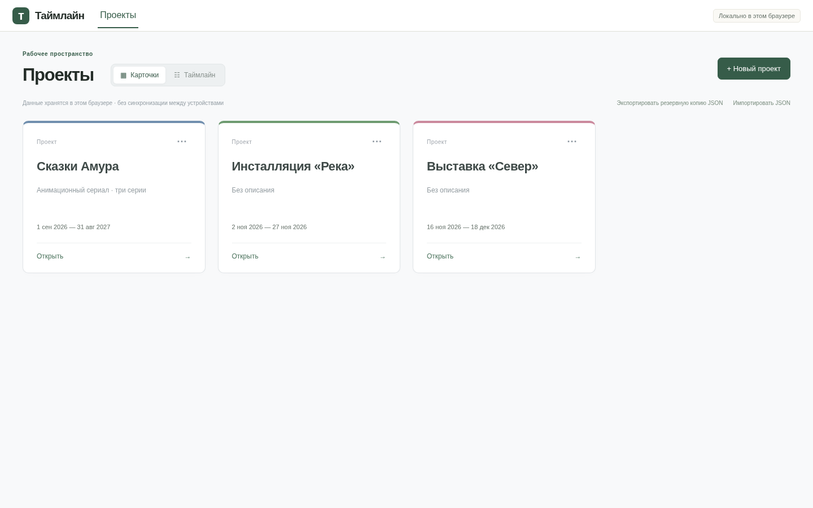

# Таймлайн — V1.2 «Проекты: карточки и портфель»

Локальное приложение для производственных планов: реальные проекты, два представления одного списка, сохранение в IndexedDB и внутренний календарный редактор V1.1. Стек сохранён: Vite, React, TypeScript strict, Zod; для хранилища добавлен Dexie. Актуальный контракт — [единое ТЗ V1.2](docs/specs/TIMELINE_V1_2_SINGLE_TZ.md).

При запуске открывается **«Проекты»**. Первый запуск новой пустой базы добавляет один пример «Сказки Амура». Другие проекты на скриншотах созданы через настоящие формы в браузерном тесте; приложение не создаёт их автоматически.



[Портфель 1440×900](docs/screenshots/projects-v1-2-portfolio-1440.png) · [Портфель 1920×1080](docs/screenshots/projects-v1-2-portfolio-1920.png) · [Внутренний редактор 1440×900](docs/screenshots/projects-v1-2-inner-editor-1440.png). Все четыре файла — реальные снимки работающего приложения. Исторические снимки V1/V1.1 сохранены.

## Запуск и проверки

Node.js **24.19.0** (`.nvmrc`), npm. Команды выполняются из корня репозитория:

```sh
npm install
npm run dev
```

Для чистой установки по lockfile: `npm ci`. При наличии nvm: `nvm install && nvm use`.

```sh
npm run lint
npm run build
npm run test
npx playwright install --with-deps chromium
npm run test:e2e
```

`build` включает strict typecheck приложения, конфигураций и тестов, затем Vite. `test` запускает Vitest, `test:watch` — режим наблюдения. Playwright поднимает production preview самостоятельно, поэтому сначала нужна актуальная сборка. Для установленного в этой облачной среде Chromium:

```sh
npm run build
PLAYWRIGHT_CHROMIUM_EXECUTABLE_PATH=/usr/bin/chromium npm run test:e2e
```

Просмотр собранного приложения отдельно: `npm run preview`. Сервер приложения, вход, ключи API, Supabase, AI и настройки сети не требуются. После установки зависимостей приложение не обращается к внешним сервисам.

## Что работает

- **Карточки / Таймлайн** — два вида одних сохранённых документов. Переключатель находится только на экране «Проекты»; выбранный режим сохраняется при переходах и F5.
- Карточки показывают название, описание, явный диапазон и стабильный цветовой акцент. «Открыть» ведёт в редактор; «···» — переименование/описание, полная копия и удаление с подтверждением.
- Портфель — настоящая календарная сцена: строка на проект, фиксированная колонка названий, единые CalendarCell/камера/геометрия V1.1. Вложенные работы здесь не показываются. Начальный zoom 14 px/день, месяцы и шесть шагов grid/snap, выходные, сегодня, pan двумя способами, zoom и «Все проекты». Последняя команда учитывает все проекты и отдалённые даты; fit многолетнего диапазона может быть мельче обычного рабочего zoom.
- Клик полосы открывает проект. Протаскивание тела не двигает даты и не открывает проект случайно. Перенос запускается только за ⠿, показывает preview/дельту, подтверждается pointerup; Esc, pointercancel, потеря захвата и blur отменяют его. Изменения длительности проекта за края нет в этом этапе.
- Перенос проекта применяет одну календарную дельту к его границам/якорю, всем процессам, всем задачам и маркерам, каждую сущность один раз. Длительности, дорожки, назначения, статусы, люди и StageBand-ссылки сохраняются. Один проверенный агрегат записывается одной транзакцией; preview в базу не пишется.
- «+ Новый проект» есть в обоих видах: название, описание, начало и окончание включительно. Новый проект пустой: только явный диапазон и стартовая дорожка. В редакторе работают **«+ Процесс» / «+ Задача»**, простые формы дат и выбора своей/новой дорожки. Пересечения в одной дорожке отклоняются, задача при необходимости расширяет родителя. Остальные строки не переупаковываются.
- Копия получает новые UUID всех проектных сущностей, новые метаданные и корректно переназначенные ссылки, включая раскрытые ID. Даты, процессные цвета и сохранённое представление наследуются. Person ID сохраняются; сами объекты копии независимы. Изменение копии не меняет оригинал.
- Редактор V1.1 сохранён: рабочий календарь, Today/Fit, дата этапа вводом и drag, несколько раскрытых процессов, inline-имена и инспектор, выделенные move/resize handles, расширение родителя, коллизии, hover исполнителей. Название/ручка длинной полосы остаются в видимой части. Фактические границы не меняются при pan/zoom.
- `#/projects` и `#/projects/:id` обеспечивают переносимые ссылки на GitHub Pages и браузерный Back. Переименование обновляет карточки, портфель, шапку и заголовок вкладки. Удаление активного проекта возвращает к списку; устаревшая ссылка показывает понятное состояние.

## Локальное сохранение и надёжность

База **`timeline-workspace`**, Dexie schema version **1**:

- `documents`: полный валидируемый ProjectDocument, ID, ревизия, updatedAt;
- `preferences`: режим/камера/шаг/выходные портфеля и отдельные представления редакторов;
- `metadata`: schemaVersion и однократный initialized.

Демо и флаг инициализации создаются в общей транзакции, только если база ещё не инициализирована и документов нет. Существующие записи не заменяются. После удаления последнего проекта и F5 демо не возвращается. Предыдущий V1.1 постоянной базы не имел: текущая версия вводит начальную схему, а не выдуманную миграцию несуществовавших данных. Неподдерживаемая версия/ошибка хранилища показывает сообщение и не сбрасывает базу.

Изменения сохраняются после подтверждения формы или жеста. Статус «Сохраняется…» показывает выполняющуюся запись, включая настройки представления. Pan/zoom/раскрытия редактора хранятся отдельно от расписания и не увеличивают его ревизию; pointermove не записывает preview. При конфликте ревизий запись отклоняется, загружается актуальное состояние и предлагается повторить действие. Это защита от потери правок, а не обещание realtime-синхронизации вкладок.

Это **данные данного браузера и origin**, без синхронизации между устройствами. Localhost, GitHub Pages и другой профиль браузера имеют отдельные базы. Очистка данных сайта может удалить проекты: для переноса и страховки используйте JSON-бэкап.

## JSON-бэкап

На экране «Проекты»:

1. **«Экспортировать резервную копию JSON»** скачивает все актуальные документы и настройки портфеля в versioned envelope `timeline-backup`, version 1.
2. **«Импортировать JSON»** сначала проверяет JSON, версию, UUID, все даты, ссылки и уникальность проектных ID. До подтверждения данные не записываются; показываются число проектов и совпадения ID.
3. При совпадениях доступны импорт всех документов как независимых копий с новыми ID либо отмена. Существующие данные не перезаписываются. При отсутствии конфликтов можно сохранить исходные ID или тоже выбрать копии.
4. Все документы и настройки импортируются одной транзакцией. Ошибка хотя бы одного документа отменяет весь импорт. Повторно проверяются коллизии непосредственно в транзакции.

JSON — перенос данных, не PDF. Восстановление настроек из копии может изменить выбранный вид/камеру портфеля, но не даты существующих проектов.

## Архитектура и изменённые модули

```text
src/application/workspace/
  model.ts                    # prefs, backup schema, port, conflict error
  projectOperations.ts        # blank, deep clone, shift, add process/task
  portfolio.ts                # range projection and stable colors
  WorkspaceService.ts         # one write entrypoint, validation, timestamps
  projectOperations.test.ts
src/infrastructure/local/
  IndexedDbProjectRepository.ts       # Dexie + atomic aggregate storage
  IndexedDbProjectRepository.test.ts
src/features/projects/
  ProjectsPage.tsx  ProjectCardGrid.tsx  ProjectActions.tsx
  PortfolioTimeline.tsx  ProjectDialog.tsx
src/features/timeline/
  CreateWorkDialog.tsx  TimelineWorkspace.tsx
  TimelineBar.tsx  DetailsInspector.tsx
src/app/App.tsx  src/main.tsx  index.html
src/domain/timeline.ts         # explicit fit also handles multi-year portfolios
src/infrastructure/demo/production.ts
src/styles/projects.css
package.json  package-lock.json
tests/e2e/{projects,timeline,calendar}.spec.ts
docs/specs/TIMELINE_V1_2_SINGLE_TZ.md
docs/adr/0005-projects-local-v1-2.md
```

UI не пишет в IndexedDB. `WorkspaceService` использует порт `WorkspaceRepository`, расширяющий исходный `ProjectRepository`. Чистые операции имеют инъекцию ID/часов; updatedAt назначается на commit, а не на preview. [ADR 0005](docs/adr/0005-projects-local-v1-2.md) фиксирует хранение, ID, навигацию и границы версии.

## Результаты проверок

До изменений проверен `main` **8535428**: lint/build, 90 unit-тестов и 20 Playwright-сценариев прошли. После реализации: **110 unit/integration тестов**, включая fake-indexeddb транзакции, и **29 браузерных сценариев Chromium**.

Проверены copy ID/связей/людей/представления, сдвиг всех дат и неизменность другого проекта, пустой проект с настоящими работами, пересечения, optimistic revisions, повторное открытие базы, отсутствие повторного seed, rollback batch import, JSON и preferences. В браузере пройдены оба вида, формы/копия/удаление, F5, Back, перенос на семь дней через настоящую ручку и отсутствие записи до pointerup, Esc, geometry/pan/zoom/Today/fit, невалидный импорт, storage error и отсутствующий проект. Сохранены регрессии V1.1; старт через список и ожидания долговременного сохранения обновлены под V1.2. Тесты используют отдельные браузерные контексты и тестовые БД, а не очистку пользовательской базы.

## Что остаётся за границами V1.2

V1.3: Undo/Redo, Shift-множественный выбор, перенос существующих работ между строками, удаление процессов/задач и расширенные операции. V1.4: полный инспектор, редактирование/поиск людей, лиды и раскрываемые группы. Сейчас строки исполнителей плоские и read-only; люди хранятся в документах с общей идентичностью ID, но без фиктивной глобальной синхронизации карточек. Глобальная таблица людей потребует отдельной миграции и политики объединения записей.

V1.5: PDF настроенного вида. Сервер, auth, realtime, guest links, мобильный редактор и ChatGPT — будущие отдельные этапы. В этой версии их нет. Основные браузерные проверки проведены в Chromium; Firefox/WebKit отдельно не проверены.

## Публикация

Разработка V1.2 — ветка `feat/projects-portfolio-v1-2`. После проверок изменения включаются в `main` и публикуются сразу, согласно принятому порядку. Workflow `.github/workflows/pages.yml` повторяет lint/unit/build/e2e, затем развёртывает `dist`.

Адрес приложения: `https://messagetomedium.github.io/TIMELINE/`. Статус конкретной публикации подтверждается через GitHub Actions, а не самим наличием этой ссылки. Относительные ресурсы Vite и hash-навигация работают по пути `/TIMELINE/`.
