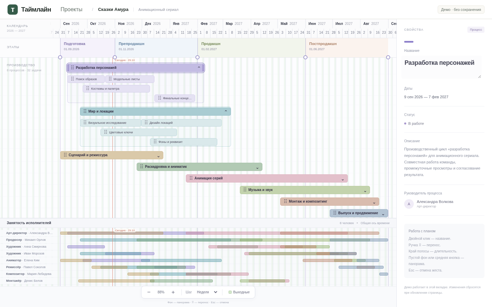

# Таймлайн — визуальный V1

Настольный браузерный редактор производственного плана. В этой итерации выполнен **V1 из нового задания**, поверх существующего Vite + React + TypeScript strict + Zod. При запуске сразу открывается временная сцена «Сказки Амура»: год, четыре этапа, восемь процессов, 32 задачи, восемь исполнителей и 40 назначений.

Новый комплект требований лежит в [docs/specs](docs/specs/04_CODEX_FIRST_PROMPT.md) и имеет приоритет перед прежними `ARCHITECTURE.md` / `CODEX_SPEC.md`. [PDF-референс](docs/reference/production-timeline.pdf) использован для плотной горизонтальной композиции, а не как изображение интерфейса. Упомянутый в задании `00_START_HERE.md` не был приложен.



Дополнительно: [снимок 1920×1080](docs/screenshots/timeline-v2-wide.png). Это реальные screenshots браузера; обе раскрытые группы, люди и инспектор доступны сразу после загрузки.

## Запуск

Node.js **24.19.0**, npm. Команды — из корня репозитория:

```sh
npm install
npm run dev
```

Для установки точно по lockfile: `npm ci`. При наличии nvm можно предварительно выполнить `nvm install && nvm use`.

```sh
npm run lint
npm run build
npm run test
npx playwright install --with-deps chromium
npm run test:e2e
```

`build` выполняет strict typecheck приложения, инструментов и тестов, затем сборку Vite. `test:e2e` сам запускает и останавливает `vite preview`, поэтому нужна актуальная сборка. В текущей облачной среде проверяется установленный Chromium:

```sh
npm run build
PLAYWRIGHT_CHROMIUM_EXECUTABLE_PATH=/usr/bin/chromium npm run test:e2e
```

Playwright также обновляет два screenshot-файла в `docs/screenshots/`. Для просмотра production-сборки отдельно: `npm run preview`. Приложению не нужны вход, сервер, API-ключи, настройка сети, Supabase или ChatGPT. После установки зависимостей оно работает без внешних запросов.

## Что работает

- Общая горизонтальная календарная ось: ruler с месяцами и датами, прозрачная сетка, этапы, процессы, задачи и занятость. Даты определяют ширину полос; CSS-позиции не зашиты в демо.
- Четыре StageBand с общими StageMarker-границами. Круглая ручка меняет дату; подписи и обе соседние области обновляются. Этапы не являются контейнерами процессов.
- Клик по процессу выделяет его, показывает свойства и раскрывает task lanes; другие процессы остаются раскрыты. Шеврон отдельно сворачивает группу. Параллельность/последовательность задана дорожками, без автоупаковки.
- Двойной клик по названию полосы — inline-ввод; Enter подтверждает, Esc отменяет. Название в правой панели тоже редактируется, Enter или уход из поля подтверждает его. Остальные поля инспектора пока только для чтения.
- Маленькая ручка ⠿ переносит процесс/задачу с календарным snap. Левый и правый края меняют длительность. Обычное нажатие/протаскивание текста не переносит работу.
- Перенос процесса сдвигает детей ровно один раз. Выход задачи за родительские даты расширяет процесс. Нельзя обрезать детей процессом, создать нулевой интервал или наложить работы в одной дорожке; ошибка объясняется рядом со сценой.
- Pointermove показывает временный preview; pointerup подтверждает один результат. Esc, pointercancel, потеря захвата и blur отменяют жест.
- ЛКМ на пустом фоне и удержание средней кнопки — pan без изменения данных. `+`/`−` масштабируют относительно центра viewport. Шесть шагов grid/snap независимы от zoom; недели начинаются с понедельника, месяцы — настоящие календарные.
- «Выходные» переключает бледно-зелёные полосы и не меняет сроки. Линия «Сегодня» использует локальную дату устройства и обновляется в полночь/при возвращении на вкладку.
- Нижняя занятость использует ту же камеру. Hover задачи/процесса подсвечивает назначенных людей; hover полосы занятости подсвечивает связанную работу.
- Кнопка «Проекты» открывает обзор; возврат к проекту сохраняет изменения документа в текущем сеансе.

## Что пока не работает

**Данные только в памяти вкладки; перезагрузка сбросит изменения.** IndexedDB, autosave, создание/копирование/удаление проектов и JSON backup/import — V4. Интерфейс `ProjectRepository` сохранён, адаптер не имитируется.

V2 ещё не реализован: нет Undo/Redo, Shift-множественного выбора, группового переноса, смены дорожек и удаления. V3: прямой ввод дат/статусов/описания/цвета, библиотека людей и редактирование назначений. Портфолио — V5, PDF текущей сцены — V6. Декоративных кнопок для отсутствующих операций нет. Полноценный touch-редактор и Firefox/WebKit пока не проверены.

## Проверки

Unit-тесты: календарные даты и DST, branded UUID и runtime-схемы, дробная date↔x-геометрия, привязка дней/недель/месяцев, zoom, layout, перенос детей, границы процессов, коллизии и StageBand-ссылки. Тесты статических типов участвуют в `tsc -b`.

Playwright: реальная сцена и отсутствие внешних запросов/ошибок консоли, несколько раскрытых процессов, live-названия, pan обеими кнопками, zoom и все шаги сетки без изменения дат, совпадение X задач и назначений, preview/commit, перенос процесса и задачи, оба края resize, расширение родителя, Esc/pointercancel/blur, коллизии, этап, hover, явный сброс in-memory демо, screenshots двух размеров. Ни один тест не очищает существующее пользовательское хранилище.

## Основные файлы этой итерации

```text
src/domain/{ids,schema,timeline,timeline.test}.ts
src/application/{timelineCommands,timelineCommands.test,timelineLayout}.ts
src/infrastructure/demo/production.ts
src/features/timeline/
  TimelineWorkspace.tsx  CalendarLayers.tsx  TimelineBar.tsx
  PerformersSection.tsx  DetailsInspector.tsx
  useTimelineGesture.ts useLocalToday.ts
src/app/App.tsx  src/main.tsx  index.html
src/styles/{app,timeline}.css
tests/e2e/timeline.spec.ts  eslint.config.js  .gitattributes
docs/{specs,reference,screenshots}/
docs/adr/0003-visual-v1.md  README.md
```

Прежние `ProjectSummary`, малая демо-фикстура, календарные функции и их тесты сохранены. [ADR 0003](docs/adr/0003-visual-v1.md) объясняет решения и границы V1.

## Ветка и публикация

Работа ведётся в `feat/visual-timeline-v2`, основная ветка — `main`. CI проверяет push/PR. `.github/workflows/pages.yml` публикует только `main` или явно выбранную ветку при ручном запуске; отправка feature-ветки не обновляет сайт автоматически.

Основной адрес репозитория: `https://messagetomedium.github.io/TIMELINE/`. Публикация предыдущей версии была подтверждена; наличие этого адреса **не означает, что новый V1 уже развёрнут**. Новый редактор сначала проверяется в feature-ветке. Ресурсы Vite относительные (`base: './'`), поэтому работают на пути проекта Pages. Для первоначальной настройки Pages используется **Settings → Pages → Source: GitHub Actions**.

Следующий этап: V2 — безопасные команды с историей undo/redo, затем Shift-группы и перенос между дорожками. Готовые атомарные операции V1 — основа этого слоя.
