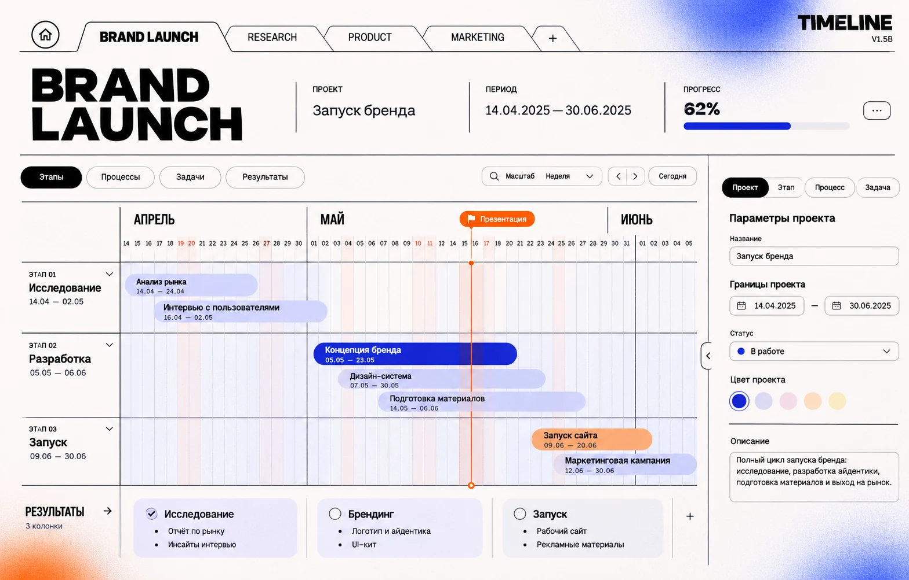
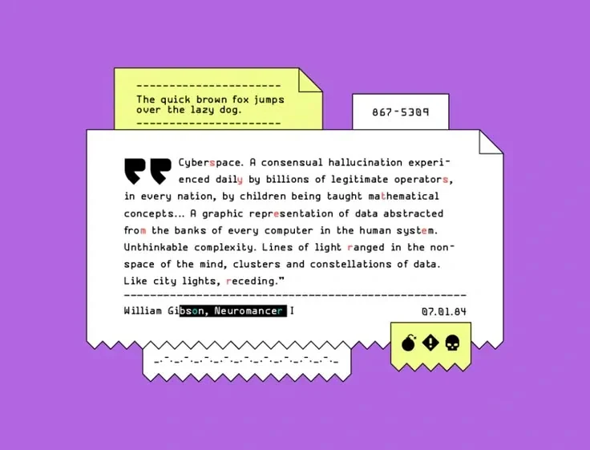
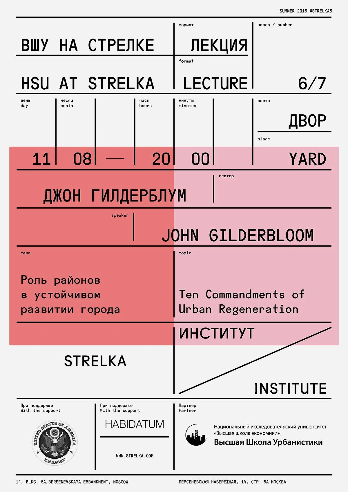
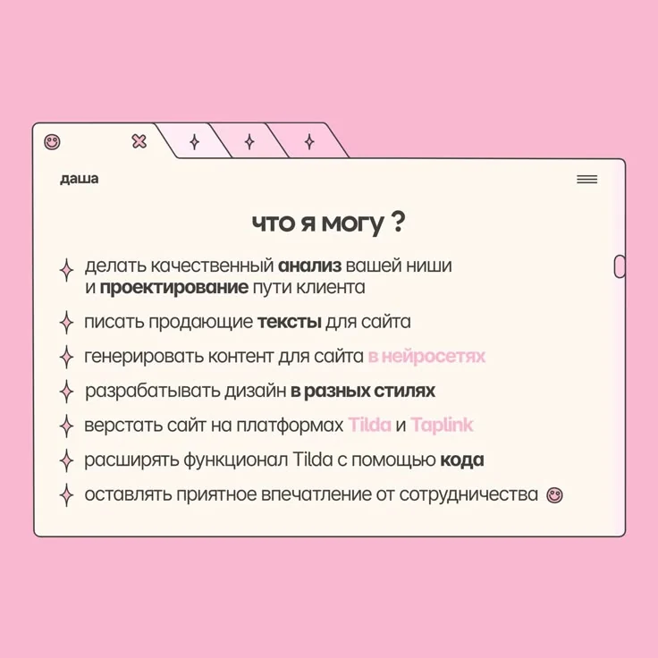
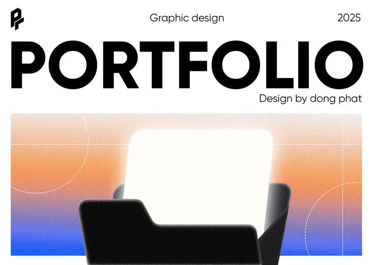

# TIMELINE — дизайн-система и визуальные референсы

**Статус:** художественное направление утверждено пользователем; редизайн **ещё не поручен к реализации**. Разработка текущих функциональных версий идёт по отдельному плану.

Эта папка — постоянный источник визуального направления для Codex. Все 5 изображений сохранены **в самом репозитории** в формате WebP с сохранением пропорций; это не внешние ссылки.

## Что читать и в каком порядке

1. **DESIGN_SYSTEM_V2.md** — основное утверждённое визуальное ТЗ: айдентика, цвета, типографика, папки, таймлайн, результаты, инспектор, формы, эффекты и ограничения.
2. **references/README.md** — назначение каждого из пяти изображений, что можно заимствовать, а что нельзя.
3. **CODEX_HANDOFF.md** — готовый контекст/инструкция для отдельного будущего задания Codex.
4. **../TIMELINE_MASTER_PLAN.md** и корневой **../../AGENTS.md** — приоритетный функциональный контракт, архитектура, релизы и правила работы.

**Главная идея:** белая графическая рабочая среда + основной синий Кляйна (#002FA7) и digital blue (#2457FF) + чёрная массивная типографика + редкий оранжевый контраст (#FF6A00) + исключительно тонкие линии, большие отступы, глубокие скругления, деликатные градиенты, grain и glow.

## Галерея исходных направлений

| № | Референс | Для чего использовать |
|---|---|---|
| 01 | [Образец TIMELINE](references/01-timeline-concept.webp) | Композиционная схема: папочная навигация, редактор, инспектор, календарь; **не** источник новых функций |
| 02 | [Цифровой документ](references/02-digital-document.webp) | Слои цифровой бумаги, язычки, техническая типографика, характер контуров |
| 03 | [Графическая сетка](references/03-strelka-typographic-grid.webp) | Контраст крупного текста и очень тонких линий; модульная верстка и плотная типографическая иерархия |
| 04 | [Окно-папка](references/04-folder-window.webp) | Силуэт открытой папки, верхние язычки и единый лёгкий контур |
| 05 | [Editorial typography](references/05-portfolio-editorial.webp) | Массивный заголовок, белое пространство, цветовые поля с grain и мягкое свечение |

**Важно:** цвета сторонних референсов (розовый, фиолетовый, кислотный жёлтый) не входят в фирменную палитру TIMELINE. Все показанные в макете проценты, иконки, таблицы или другие функции не становятся автоматически требованиями приложения.

Референсы используются для анализа формы, композиции и визуального настроения; подробные правила — в дизайн-системе.